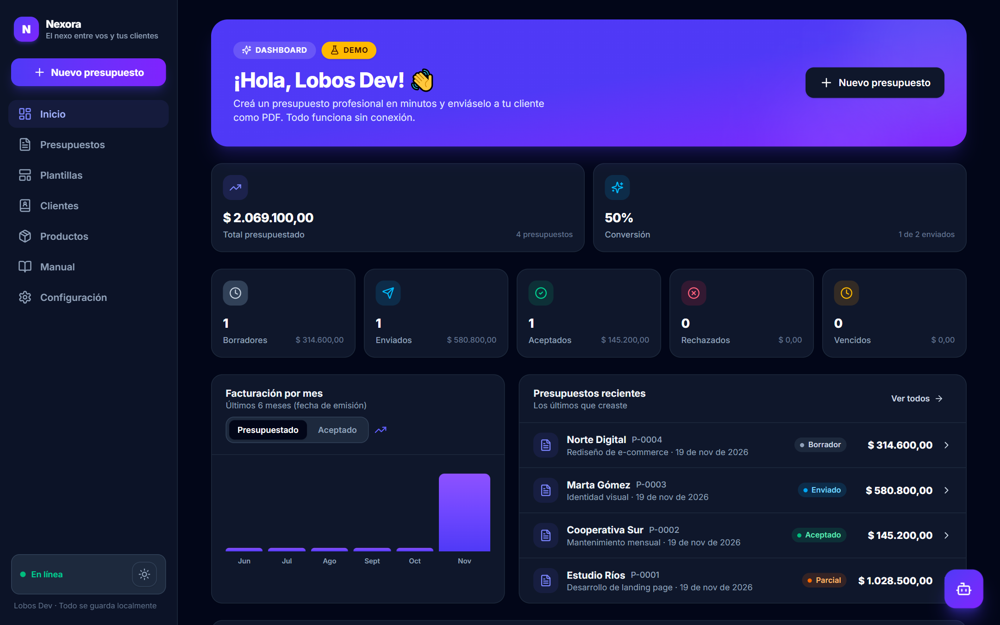
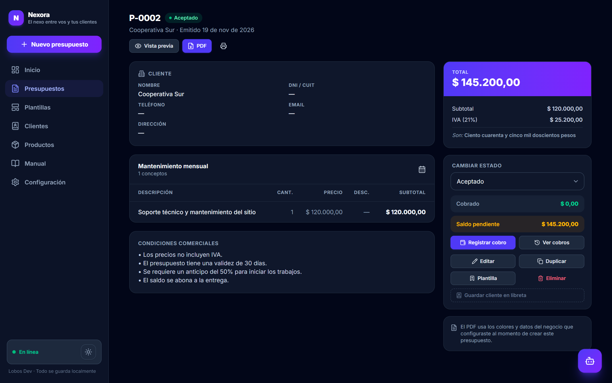
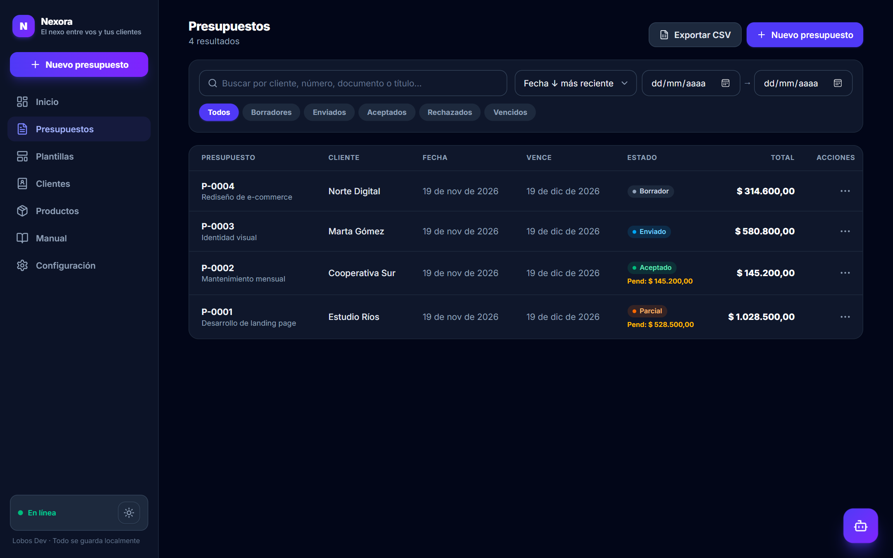
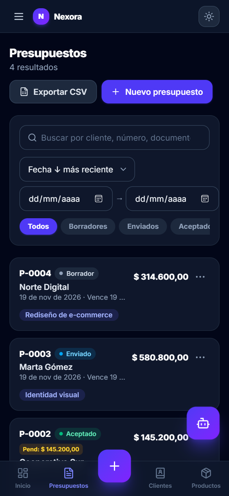

<div align="center">

# Nexora

### Presupuestos profesionales que funcionan 100% offline

Sin backend, sin cuentas, sin servidores: **tus datos viven solo en tu dispositivo** (IndexedDB).

[](https://nexora-pied-mu.vercel.app)
[](MANUAL.md)


</div>

---

## 📸 Capturas

<p align="center">
  
  
</p>
<p align="center">
  
</p>
<p align="center">
  
</p>

## ✨ ¿Qué es Nexora?

Nexora (de *nexo*: une al profesional con su cliente) es una **PWA para profesionales y pequeños negocios** que necesitan presupuestar, enviar propuestas y cobrar sin depender de internet ni pagar servidores.

Todo el ciclo en una sola app: **presupuesto → PDF → envío → estado → cobro**.

> ⚠️ Es una **versión demo**: los datos se guardan en el `IndexedDB` del navegador y nunca se envían a internet. Si borrás los datos del navegador o cambiás de dispositivo, se pierden (usá el respaldo JSON).

## 🚀 Funcionalidades

### Presupuestos
- Datos del negocio, logo y condiciones comerciales reutilizados automáticamente.
- Conceptos con cantidad, precio, descuento por ítem, descuento general e IVA configurable (0 / 5 / 10,5 / 21 / 27 / personalizado).
- **Numeración correlativa automática** (`P-0001`), sin números repetidos.
- **Borrador automático** al salir a mitad de camino + aviso de cambios sin guardar.
- Autocompletado de **clientes** y **productos** mientras escribís.
- **Plantillas** reutilizables y botón "desde plantilla".
- Duplicar, editar, cambiar estado y eliminar.

### PDF profesional
- Logo, datos del negocio y del cliente, tabla de conceptos, totales, **importe en letras**, observaciones y condiciones.
- Colores configurables, presets y modo **blanco y negro** para ahorrar tinta.
- Vista previa, descargar, imprimir, compartir nativo (Web Share), WhatsApp y email.

### Estados y cobros
- Estados del presupuesto: borrador, enviado, aceptado, rechazado y **vencido** (automático).
- **Cobros parciales o totales** sobre el presupuesto: registrás cada pago con su fecha y el estado pasa a **parcial** o **cobrado**.
- **Historial de cobros** y **saldo pendiente** siempre visible.
- Ideal para señas y pagos en cuotas.

### Gestión
- **Dashboard**: total presupuestado, estados, **tasa de conversión** (aceptados / enviados) y facturación por mes.
- **Historial** con búsqueda, filtros por estado/fecha, orden y export a CSV.
- **Clientes**: libreta con buscador y total presupuestado por cliente.
- **Productos**: catálogo con precio, unidad (hora, m², día…), imagen opcional, facturación por producto y export CSV.
- **Configuración**: negocio + logo, moneda, IVA, numeración, colores del PDF, tema claro/oscuro/sistema y canales de envío.
- **Respaldo**: exportar/importar todo en JSON.

### PWA / offline
- Instalable en celular y PC (íconos, modo standalone, aviso de instalación).
- **100% offline** después de la primera carga.
- Tema oscuro por defecto (claro/oscuro/sistema).
- Barra de estado "sin conexión" cuando no hay red.

## 🧩 Problemas que resuelve

| Problema | Solución |
|---|---|
| Armar propuestas desde cero | Plantillas, autocompletado y datos del negocio reutilizados |
| Perder el trabajo a mitad de camino | Borrador automático y aviso de cambios sin guardar |
| Errores de cálculo | Descuentos, IVA, totales e importe en letras al instante |
| No saber qué propuestas cerraron | Estados + tasa de conversión en el dashboard |
| Perder el registro de cobros y señas | Cobros parciales con historial y saldo pendiente |
| Numeración inconsistente | Correlativa y automática, sin repetir números |
| PDFs poco profesionales | PDF con logo, colores configurables e importe en letras |
| Depender de internet o pagar servidores | PWA offline con IndexedDB, sin backend |

## 🛠 Stack

| Capa | Tecnología |
|---|---|
| UI | React 19 + TypeScript |
| Build | Vite 6 |
| Estilos | Tailwind CSS v4 |
| Persistencia | IndexedDB + [Dexie.js](https://dexie.org/) |
| PDF | jsPDF + jspdf-autotable |
| Offline / instalable | `vite-plugin-pwa` (Workbox) |
| Tests | Vitest |
| Deploy | Vercel (estático) |

## ⚡ Cómo correrlo

```bash
npm install        # instalar dependencias
npm run dev        # servidor de desarrollo
npm run build      # typecheck + build de producción (con PWA)
npm run preview    # probar el build (y el modo offline)
npm test           # tests unitarios (cálculo, dinero, fechas, PDF)
npm run icons      # regenerar íconos PNG de la PWA
```

## 🏗 Arquitectura

```
src/
├── components/        # pantallas y UI (Dashboard, QuoteForm, QuoteDetail, Settings…)
├── lib/
│   ├── storage.ts     # capa de persistencia (IndexedDB / Dexie)
│   ├── calc.ts        # totales, descuentos, IVA, cobros
│   ├── money.ts       # formato de moneda e importe en letras
│   ├── dates.ts       # fechas y vencimientos
│   ├── pdf.ts         # generación del PDF
│   ├── csv.ts         # exportaciones
│   └── share.ts       # Web Share / WhatsApp / email
├── store/AppContext.tsx   # estado global y acciones
└── types.ts               # modelos de dominio
```

Decisiones clave:

- **Offline-first por diseño**: toda la app es cliente; la persistencia es local y no hay API.
- **Capa de datos aislada** en `storage.ts`, para poder migrar a sincronización en la nube sin tocar la UI.
- **Numeración centralizada**: el correlativo se calcula en un único lugar para que nunca se repita.
- **Lógica testeada**: cálculos de dinero, fechas, totales y PDF tienen tests unitarios con Vitest.

## ✅ Tests

```bash
npm test
```

Cubren cálculo de totales/IVA/descuentos, formato de dinero e importe en letras, fechas/vencimientos y armado del PDF.

## 🔒 Privacidad

- **Nada se envía a internet**: no hay backend, analytics ni cuentas.
- Los datos viven en el `IndexedDB` del navegador, en ese dispositivo.
- Para mover datos entre dispositivos: **Configuración → exportar JSON** e importarlo en el otro.
- Limpiar los datos del navegador borra la información (por eso conviene exportar respaldos).

## 🗺 Roadmap

- [ ] Sincronización entre dispositivos y respaldo en la nube (offline-first + sync).
- [ ] Cuentas de usuario y multi-dispositivo.
- [ ] Recordatorios de vencimiento.
- [ ] Más plantillas y presets de PDF.

## 👤 Autor

**Agustín Verga Lobos** — Analista en Sistemas

[](https://www.linkedin.com/in/agustin-verga-lobos-951a26267/)
[](https://www.instagram.com/lobos_dev/)
[](https://github.com/Vlobos01)

## 📄 Licencia

Proyecto personal publicado con fines de muestra. © Agustín Verga Lobos — todos los derechos reservados.
Si querés usar el código o parte de él, escribime.

---

<div align="center">
<sub>Hecho con React + IndexedDB. Sin servidores, sin excusas.</sub>
</div>
